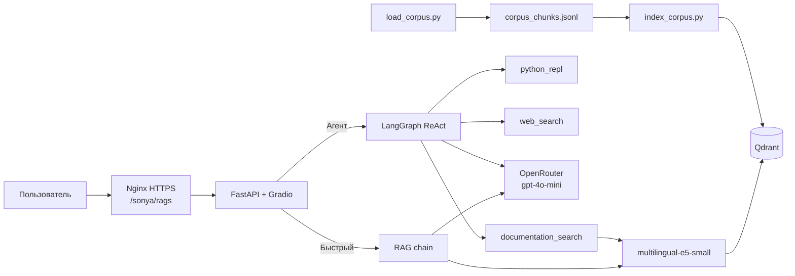

# scikit-learn docs RAG + LangGraph agent

[](https://github.com/BykovchenkoS/sklearn-docs-rag/actions/workflows/ci.yml)
[](https://github.com/BykovchenkoS/sklearn-docs-rag/actions/workflows/deploy.yml)


AI-ассистент по официальной документации scikit-learn с двумя режимами:
**Быстрый RAG** (поиск по корпусу) и **Агент** (LangGraph ReAct), который сам
выбирает инструменты — поиск в документации, вычисления в Python, поиск в сети.

**Живой сервис:** <https://89-110-100-156.nip.io/sonya/rags/>

## Возможности

- **Два режима в одном UI**: «Быстрый (/chat)» и «Агент (/agent)».
- **Ответы с цитатами** `[1]`, `[2]` и панелью источников (URL документа).
- **Русский и английский**: мультиязычный эмбеддер `multilingual-e5-small`.
- **Стриминг**: ответ печатается по токенам, видны статус, TTFT и тайминги.
- **«Не знаю»** для вопросов вне корпуса, без выдуманных фактов.
- **LaTeX-формулы** (Ridge, Lasso, метрики) рендерятся в чате.
- **Агент с tools**: `documentation_search`, `python_repl`, `web_search`.
- **Multi-hop**: «найди alpha в доках → посчитай alpha*10 в Python» — два
  инструмента подряд.
- **Trace «Что сделал агент»**: пошагово видны tool, аргументы и результат.
- **Guardrails**: regex-фильтр prompt-injection на входе, source-grounding и
  лимит длины на выходе.
- **Structured logging**: JSON-логи с `thread_id`, `tool`, `latency_ms`.
- **CI/CD**: тесты на PR, сборка образа в GHCR, автодеплой на VPS.

## Архитектура



- **Индексация** отделена от запросов: скрипт нарезает корпус и пишет векторы
  в Qdrant, приложение при старте загружает эмбеддер и ищет по коллекции.
- **Быстрый режим**: вопрос → эмбеддинг → top-4 чанка → промпт → LLM → ответ.
- **Агент**: LLM выбирает tool, `ToolNode` выполняет его, результат
  возвращается в LLM; цикл ограничен `max_iterations` и сохраняется в
  `MemorySaver` по `thread_id`.

## Стек

| Слой | Технология |
|---|---|
| API и UI | FastAPI, Gradio 5 |
| RAG | LangChain LCEL |
| Агент | LangGraph (ReAct, ToolNode, MemorySaver) |
| Векторная БД | Qdrant 1.12 |
| Эмбеддинги | `intfloat/multilingual-e5-small` (384, cosine) |
| LLM | OpenRouter, `openai/gpt-4o-mini` |
| Оценка | RAGAS 0.2.15 |
| Логи | structlog (JSON) |
| Инфраструктура | Docker, GitHub Actions, GHCR, nginx, Let's Encrypt |

## Быстрый старт

```bash
conda create -y -n sklearn-docs-rag python=3.11
conda activate sklearn-docs-rag
pip install -r requirements.txt
```

Создать `.env` по образцу `.env.example` и указать ключ OpenRouter:

```bash
LLM_API_KEY=sk-or-v1-...
```

Поднять Qdrant, собрать корпус и проиндексировать его:

```bash
docker compose up -d qdrant
python -m app.scripts.load_corpus
python -m app.scripts.index_corpus
```

Запустить сервис:

```bash
uvicorn app.main:app --reload
```

- Чат: <http://localhost:8000> (переключатель режимов справа)
- Swagger: <http://localhost:8000/docs>
- CLI-проверка агента: `python -m app.agent.runner "What is Ridge regression?"`

## REST API

**Быстрый RAG** — `POST /chat`:

```bash
curl -X POST http://localhost:8000/chat \
  -H "Content-Type: application/json" \
  -d '{"question": "What is ElasticNet?"}'
```

**Агент** — `POST /agent`:

```bash
curl -X POST http://localhost:8000/agent \
  -H "Content-Type: application/json" \
  -d '{"question": "What is the default alpha in Ridge? Compute alpha * 10 with python_repl"}'
```

Ответ агента:

```json
{
  "answer": "...",
  "trace": [
    {"step": 1, "node": "agent", "tool": "documentation_search", "input": {"query": "Ridge alpha default"}, "output": "...", "latency_ms": 0},
    {"step": 2, "node": "agent", "tool": "python_repl", "input": {"code": "print(1.0 * 10)"}, "output": "10.0", "latency_ms": 0}
  ],
  "sources": [
    {"url": "https://scikit-learn.org/stable/modules/linear_model.html", "snippet": "...", "full_context": "..."}
  ],
  "guardrail_triggered": null,
  "iterations": 3
}
```

## Корпус

Три раздела официальной документации scikit-learn + внутренний `about.md`:

- `linear_model.html` — линейные модели, Ridge, Lasso, ElasticNet
- `tree.html` — деревья решений, переобучение, гиперпараметры
- `model_evaluation.html` — метрики качества
- `data/local/about.md` — описание сервиса и его возможностей

Нарезка: 1000 символов с перекрытием 200 → **265 чанков**. Переиндексация —
повторный запуск `load_corpus` + `index_corpus` (коллекция пересоздаётся).

## Оценка качества

### RAG (W16, 10 golden-вопросов, llama-3.3-70b)

Ноутбук `notebooks/rag_eval.ipynb`, результат `notebooks/rag_metrics.json`.

| Метрика | Значение |
|---|---|
| Recall@4 | **1.00** |
| Faithfulness | **0.854** |
| Answer Relevancy | **0.862** |

### Агент vs baseline RAG (W17, 15 вопросов, gpt-4o-mini)

10 вопросов из W16 + 5 multi-hop. Ноутбук `notebooks/agent_eval.ipynb`,
результаты `baseline_metrics.json`, `agent_metrics.json`, `comparison.md`.

| Метрика | Baseline RAG | Agent |
|---|---|---|
| Faithfulness | 0.659 | **0.829** |
| Answer Relevancy | 0.812 | **0.821** |
| Tool-choice accuracy (multi-hop) | — | **100%** |
| Avg iterations | 1 | 1.7 |

Агент лучше опирается на контекст и решает все multi-hop задачи двумя
инструментами подряд.

## Структура проекта

```text
.
├── app/
│   ├── config.py            # настройки из окружения
│   ├── llm.py               # фабрика LLM-клиента
│   ├── main.py              # FastAPI, /chat, /agent, Gradio
│   ├── agent/
│   │   ├── graph.py         # LangGraph: agent ↔ tool_executor
│   │   ├── tools.py         # documentation_search, python_repl, web_search
│   │   ├── prompts.py       # системный промпт с правилами tools
│   │   ├── guardrails.py    # input/output проверки
│   │   └── runner.py        # CLI для smoke-теста
│   ├── rag/chain.py         # LCEL-цепочка
│   ├── schemas/             # chat.py, agent.py
│   └── scripts/             # load_corpus.py, index_corpus.py
├── data/local/about.md
├── notebooks/
│   ├── rag_eval.ipynb · rag_metrics.json
│   └── agent_eval.ipynb · baseline_metrics.json · agent_metrics.json · comparison.md
├── tests/                   # чат, tools, graph, guardrails
├── .github/workflows/       # ci.yml, deploy.yml
├── docker-compose.yml
├── Dockerfile
├── requirements.txt
└── README.md
```

## Конфигурация

| Переменная | По умолчанию | Назначение |
|---|---|---|
| `LLM_API_KEY` | — | ключ OpenRouter (секрет) |
| `LLM_BASE_URL` | `https://openrouter.ai/api/v1` | OpenAI-совместимый провайдер |
| `LLM_MODEL` | `openai/gpt-4o-mini` | модель |
| `QDRANT_URL` | `http://qdrant:6333` | адрес Qdrant |
| `MAX_ITERATIONS` | `5` | лимит итераций агента |
| `AGENT_TEMPERATURE` | `0.0` | температура агента |
| `ENABLE_WEB_SEARCH` | `true` | выключатель DuckDuckGo |
| `AGENT_MAX_OUTPUT_CHARS` | `2000` | лимит длины ответа |
| `ROOT_PATH` | — | префикс за reverse-proxy |

Секреты хранятся только в `.env` (не коммитится) и GitHub Secrets.

## Деплой

```text
push в main
  → CI: pytest + сборка и публикация образа в GHCR
  → Deploy: SSH на VPS, swap, docker compose
  → первый запуск: автоиндексация корпуса
  → nginx (/sonya/rags) → контейнер на 127.0.0.1:9000
```

Живой сервис: <https://89-110-100-156.nip.io/sonya/rags/>

## Ограничения и развитие

- `python_repl` выполняет код **в процессе приложения**; для публичного
  доступа нужна песочница (gVisor, Firecracker, e2b.dev).
- `MemorySaver` хранит состояние в памяти: диалог живёт до рестарта; для
 постоянного состояния нужен `PostgresSaver`.
- DuckDuckGo без ключа имеет лимиты запросов.
- Корпус ограничен тремя модулями scikit-learn.
- RAGAS 0.2.15 требует `langchain_community.chat_models.vertexai` (нет в
  community 0.4.x); в `agent_eval.ipynb` стоит безопасный shim.
- Дальше: песочница для REPL, persistent checkpointer, расширение корпуса,
  reranker и гибридный поиск.

## Для резюме

> RAG + LangGraph-агент над документацией scikit-learn: FastAPI, LangChain
> LCEL, Qdrant, `multilingual-e5-small`, инструменты `documentation_search` /
> `python_repl` / `web_search`, ReAct-цикл с лимитом итераций и checkpointer,
> guardrails и JSON-логи. Сравнительная оценка через RAGAS: agent vs baseline
> RAG (Faithfulness 0.83 vs 0.66, tool-choice accuracy 100% на multi-hop).
> CI/CD: GitHub Actions → GHCR → VPS.

---

Автор: [Софья Быковченко](https://github.com/BykovchenkoS)
