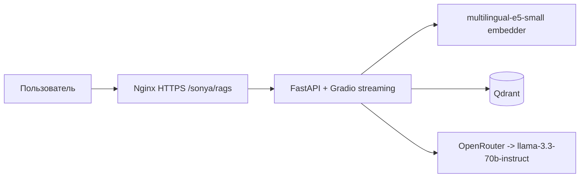

# scikit-learn docs RAG assistant

AI-ассистент по официальной документации scikit-learn: задаёте вопрос —
получаете ответ с цитатами из документации. Работает на русском и английском,
печатает ответ потоком и честно говорит «не знаю», если ответа нет в корпусе.

**Живой сервис:** https://89-110-100-156.nip.io/sonya/rags/

## Архитектура



## Метрики

Замеры на golden dataset (10 вопросов), 3 модуля scikit-learn + about.md →
265 чанков, `meta-llama/llama-3.3-70b-instruct`, `notebooks/rag_eval.ipynb`:

| Метрика | Значение | Что измеряет |
|---|---|---|
| Recall@4 | **1.00** | retriever возвращает релевантный URL во всех 10 случаях |
| Faithfulness | **0.854** | LLM-судья: ответ не противоречит контексту |
| Answer Relevancy | **0.862** | LLM-судья: ответ по делу, не уходит в сторону |

## Локальный запуск

```bash
conda create -y -n sklearn-docs-rag python=3.11
conda activate sklearn-docs-rag
pip install -r requirements.txt

docker compose up -d qdrant
python -m app.scripts.load_corpus
python -m app.scripts.index_corpus
uvicorn app.main:app --reload
```

Откройте http://localhost:8000. REST-эндпоинт: `POST /chat` с телом
`{"question": "..."}`.

## Деплой

Push в `main` → CI (тесты + сборка образа в GHCR) → Deploy (SSH на VPS,
`docker compose`, автоиндексация при первом запуске) → живой сервис на
https://89-110-100-156.nip.io/sonya/rags/

## Для резюме

> RAG-сервис над документацией scikit-learn на FastAPI + LangChain LCEL +
> Qdrant + multilingual-e5-small. Streaming-чат в Gradio, оценка качества
> через RAGAS на golden dataset (Recall@4 1.00, Faithfulness 0.854,
> Answer Relevancy 0.862).
