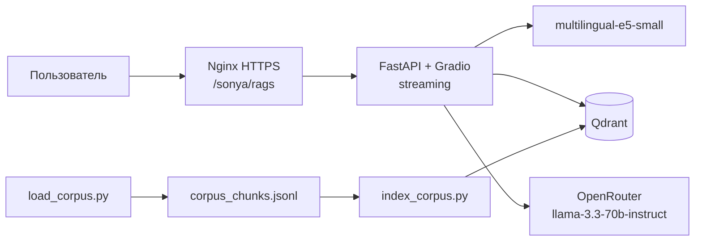

# scikit-learn docs RAG assistant

[](https://github.com/BykovchenkoS/sklearn-docs-rag/actions/workflows/ci.yml)
[](https://github.com/BykovchenkoS/sklearn-docs-rag/actions/workflows/deploy.yml)


AI-ассистент по официальной документации scikit-learn. Задаёте вопрос на
естественном языке, получаете ответ с цитатами из документации.

**Сервис:** <https://89-110-100-156.nip.io/sonya/rags/>

## Возможности

- Ответы **с цитатами** `[1]`, `[2]` и панелью источников (URL документа)
- **Русский и английский**: мультиязычный эмбеддер `multilingual-e5-small`, ответ на языке вопроса
- **Стриминг**: ответ печатается по токенам, в UI видны TTFT и тайминги
- **«Не знаю»** для вопросов вне корпуса, без выдуманных фактов
- **LaTeX-формулы** (Ridge, Lasso, метрики) рендерятся в чате
- **REST API** `POST /chat` + **Gradio-чат** на главной странице
- **Оценка качества** через RAGAS на golden dataset
- **CI/CD**: тесты на PR, сборка образа в GHCR, автодеплой на VPS

## Архитектура



Индексация отделена от обработки запросов: скрипт один раз нарезает корпус и пишет векторы в Qdrant, а приложение 
при старте загружает эмбеддер и ищет по готовой коллекции.

**Путь запроса:** вопрос -> эмбеддинг -> top-4 чанка из Qdrant -> промпт «контекст + вопрос» -> LLM -> ответ с цитатами.

## Стек

| Слой | Технология |
|---|---|
| API и UI | FastAPI, Gradio 5 |
| RAG | LangChain LCEL |
| Векторная БД | Qdrant 1.12 |
| Эмбеддинги | `intfloat/multilingual-e5-small` (384, cosine) |
| LLM | OpenRouter, `meta-llama/llama-3.3-70b-instruct` |
| Оценка | RAGAS 0.2.15 |
| Инфраструктура | Docker, GitHub Actions, GHCR, nginx, Let's Encrypt |

## Быстрый старт

```bash
conda create -y -n sklearn-docs-rag python=3.11
conda activate sklearn-docs-rag
pip install -r requirements.txt
```

Создать `.env` по образцу `.env.example` и указать ключ OpenRouter:

```bash
LLM_API_KEY=sk-or-v1-...
```

Поднять Qdrant, собрать корпус и проиндексировать его:

```bash
docker compose up -d qdrant
python -m app.scripts.load_corpus
python -m app.scripts.index_corpus
```

Запустить сервис:

```bash
uvicorn app.main:app --reload
```

- Чат: <http://localhost:8000>
- Swagger: <http://localhost:8000/docs>

## REST API

```bash
curl -X POST http://localhost:8000/chat \
  -H "Content-Type: application/json" \
  -d '{"question": "What is ElasticNet?"}'
```

```powershell
$body = @{ question = "What is ElasticNet?" } | ConvertTo-Json
Invoke-RestMethod -Uri "http://localhost:8000/chat" `
  -Method Post -ContentType "application/json" -Body $body
```

Ответ:

```json
{
  "answer": "... [1] ...",
  "sources": [
    {"url": "https://scikit-learn.org/stable/modules/linear_model.html", "snippet": "...", "full_context": "..."}
  ]
}
```

## Корпус

Три раздела официальной документации scikit-learn + внутренний `about.md`:

- `linear_model.html` - линейные модели, Ridge, Lasso, ElasticNet
- `tree.html` - деревья решений, переобучение, гиперпараметры
- `model_evaluation.html` - метрики качества
- `data/local/about.md` - описание сервиса и его возможностей

Нарезка: 1000 символов с перекрытием 200, **265 чанков**. 
Переиндексация - повторный запуск `load_corpus` + `index_corpus` (коллекция пересоздаётся).

## Оценка качества

Golden dataset: 10 вопросов (7 EN по трём модулям, 2 RU на мультиязычность, 1 мета-вопрос про `about.md`). 
Ноутбук: `notebooks/rag_eval.ipynb`, результат: `notebooks/rag_metrics.json`.

| Метрика | Значение | Что измеряет |
|---|---|---|
| Recall@4 | **1.00** | retriever вернул релевантный раздел во всех 10 случаях |
| Faithfulness | **0.854** | ответ не противоречит найденному контексту |
| Answer Relevancy | **0.862** | ответ по делу, не уходит в сторону |
